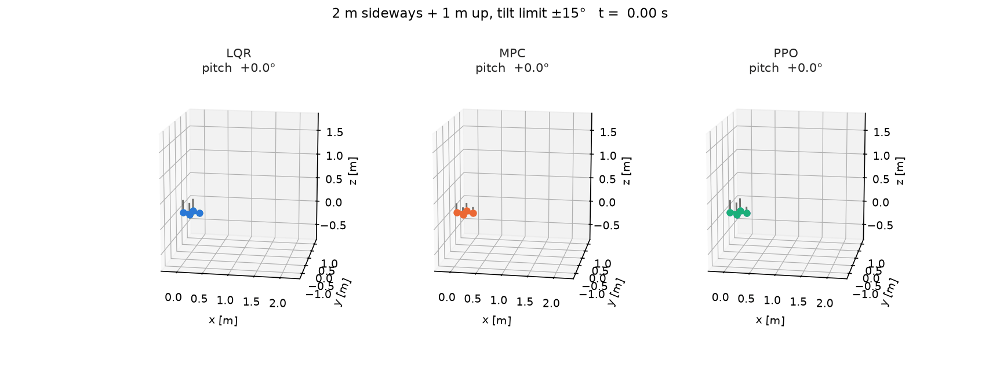
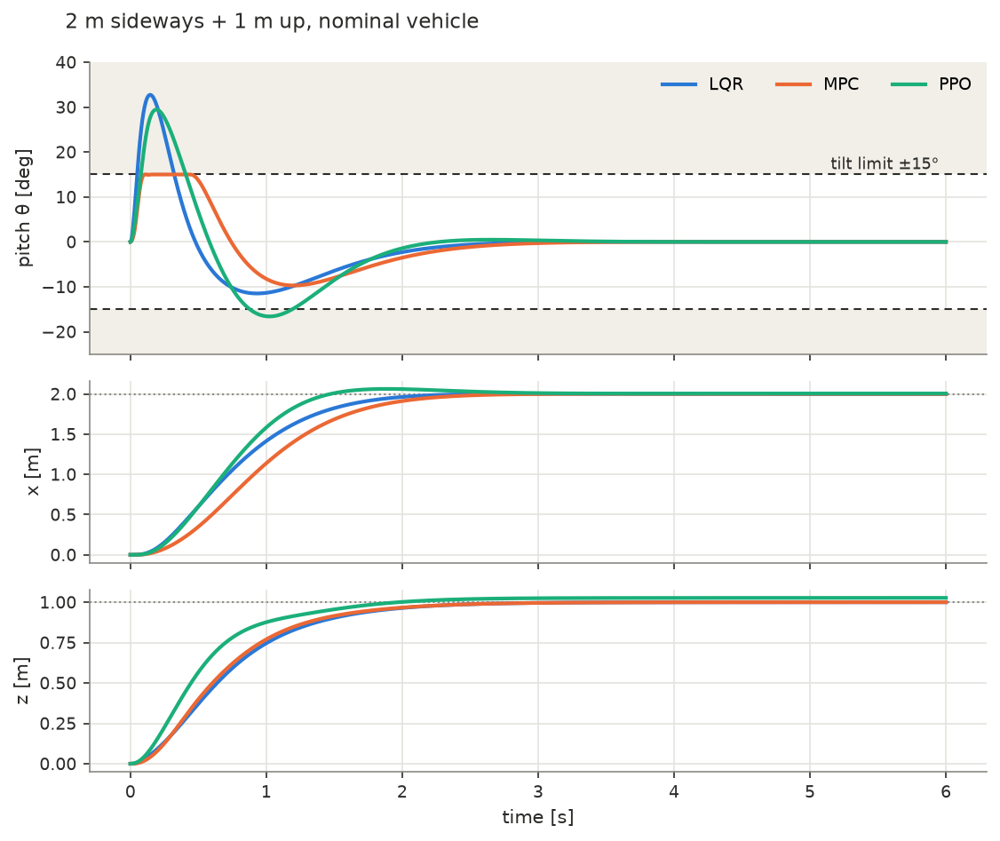
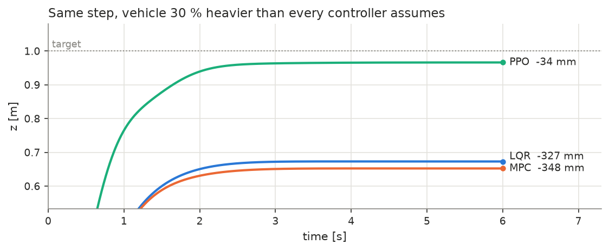
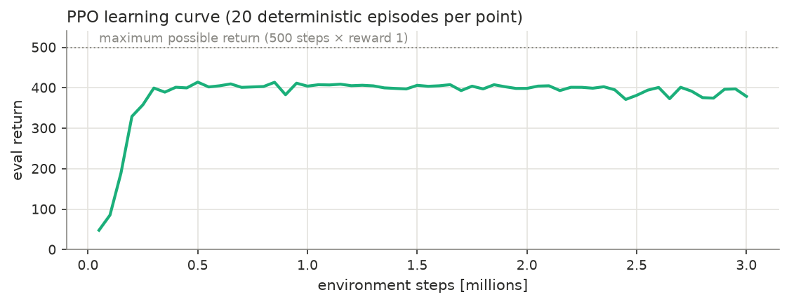

# Quadrotor control: LQR, MPC and a PPO policy on one 6-DOF model



**A PPO policy trained with randomized mass holds altitude 10× better than LQR
or MPC on a drone 30 % heavier than every controller assumes, and runs 19×
faster than the MPC — but it is the only one of the three that cannot be made
to respect the tilt limit.** MPC rides the ±15° limit to within 0.007°; PPO
learned to mostly avoid it from a reward penalty and still overshoots it by
14°.

Crazyflie-class quadrotor, 12 states, 4 rotor inputs. Same model, same
simulator, same manoeuvre for all three controllers.

## Results

Step of 2 m sideways and 1 m up from hover. Full numbers in
[`results/metrics.json`](results/metrics.json), produced by
`scripts/evaluate.py`.

| | LQR | MPC | PPO |
|---|---|---|---|
| **Nominal vehicle** | | | |
| position RMSE over the run | 0.667 m | 0.738 m | **0.638 m** |
| time to within 5 cm | **2.01 s** | 2.22 s | 2.25 s |
| final position error | 0.004 mm | 0.007 mm | 28 mm |
| peak tilt (limit 15°) | 32.7° | **15.0°** | 29.5° |
| worst excursion past the limit | 17.7° | **0.007°** | 14.5° |
| time spent past the limit | 0.27 s | 0.11 s | 0.64 s |
| **Vehicle 30 % heavier, controllers not told** | | | |
| final altitude error | −327 mm | −348 mm | **−34 mm** |
| **50 random starts, nominal** | | | |
| reached within 5 cm, no crash | 50/50 | 50/50 | 50/50 |
| **Compute per call** (median / p99) | 0.03 / 0.07 ms | 1.62 / 10.0 ms | 0.09 / 0.16 ms |
| control rate | 500 Hz | 50 Hz | 100 Hz |

MPC's p99 of 10 ms is inside its 20 ms period, so all three are real-time on
this machine. PPO's time is the network in NumPy, not PyTorch.



MPC holds pitch flat on the limit for 0.4 s and pays for it with the slowest
lateral motion. LQR and PPO both blow through it. PPO crosses it twice — up to
29.5°, then −16.6° on the rebound — which is why it spends the most time
outside even though its peak is lower than LQR's.



## What the comparison actually shows

**PPO's robustness is bought, not free.** It was trained on masses from 0.025 to
0.035 kg, cannot observe which one it has, and settled on a thrust that works
across the range. On the nominal vehicle — the light end of that range — it
therefore hovers **27 mm high**. On the heavy one it sags only 34 mm. LQR and
MPC were designed for one mass: exact on it, 33–35 cm low off it. Neither side
has integral action; the trade is a small error everywhere versus no error at
one point and a large one elsewhere. This was predicted before training
(DERIVATION §7.1) — a memoryless policy in a partially observed problem.

**The hand arithmetic agrees with the simulator.** LQR's sag is the extra
weight over its collective altitude gain: 0.078 N / 0.24 N/m = 0.33 m.
Simulated: 0.327 m.

**A reward penalty is not a constraint.** PPO's reward charges for tilt beyond
15° (DERIVATION §7.4), and its peak of 29.5° is barely below LQR's 32.7° — LQR
has no knowledge of the limit at all. MPC is the only controller here that plans against the limit — and even
its guarantee is on the linear model at sample instants, which is why the true
pitch exceeds 15° by 0.007°.

**Speed is where learning wins.** The policy is three matrix multiplies:
19× cheaper than MPC at the median, 61× at the p99. On a microcontroller that
is the difference between fitting and not.

**When to use which, on this evidence.** LQR if the model is right and the
envelope is generous. MPC if a limit must hold. PPO if the model is uncertain
and compute is scarce — with a safety filter in front of it if a limit must
also hold, which is the obvious next step.

## How it works

Full derivation, with every closed-form step tested against the code:
**[DERIVATION.md](DERIVATION.md)**. In outline:

1. **Model** — rigid body, ZYX Euler angles, four rotors in a plus
   configuration. Thrust and drag torque per rotor map to one force and three
   torques through an invertible 4×4 matrix; there is no sideways force, so the
   vehicle is underactuated by two and moves sideways by tilting.
   [`plants/quadrotor3d/model.py`](plants/quadrotor3d/model.py)
2. **Linearization** at hover splits into four decoupled integrator chains —
   the $x$ chain is $x \leftarrow v_x \leftarrow \theta \leftarrow q$, a quadruple
   integrator. Hand-derived and checked against CasADi and finite differences.
3. **LQR** — continuous Riccati, Bryson's-rule weights.
   **MPC** — the same weights, ZOH-discretized (exactly, since $A^4 = 0$),
   20-step horizon, OSQP, hard rotor bounds and a soft tilt bound with an exact
   ℓ1 penalty.
4. **PPO** — a Gymnasium environment integrating the *same* CasADi model;
   observation is the scaled state error, action is rotor thrust about hover,
   reward $e^{-c}$ so crashing never pays, mass and yaw inertia randomized per
   episode. Stable-Baselines3, 3 M steps, 30 minutes on a laptop CPU.



Learning plateaus by 0.5 M steps. The deployed policy is the best of the
periodic evaluations (at 0.5 M); with 20 episodes per evaluation the
differences between later checkpoints are inside the noise, so the 50
random-start test uses held-out seeds.

## Built on cf

Models, trim, linearization, LQR, MPC, simulation and plots come from
[cf](https://github.com/oscarhe123/Control-Framework), a control framework I
wrote. The plant here is **48 lines of `build()` plus 23 lines of parameters**,
and lives in this repository — cf finds it through its plant search path and
ships no drone code. The dynamics needed **no change to cf**. The animation did:
`cf.animate` and `cf.plant_module` were added to cf for this project, because a
plant had never needed to ship its own geometry before.

## Reproduce

```bash
pip install torch --index-url https://download.pytorch.org/whl/cpu   # CPU is enough
pip install -r requirements.txt
pytest                                 # derivation, environment and policy tests
python scripts/train_ppo.py            # ~30 min; writes models/
python scripts/evaluate.py             # ~15 min; writes results/ and figs/
```

The trained policy is committed as `models/best/best_model.zip`, so
`evaluate.py` works without training.

```
plants/quadrotor3d/   model.py (dynamics + drawing), params.yaml (sourced)
plants/quadrotor2d/   planar variant, 6 states - for fast experiments
quadrl/problem.py     weights, trim, LQR/MPC designs - defined once
quadrl/env.py         Gymnasium environment, observation and action maps
quadrl/policy.py      trained policy as a cf Controller, NumPy forward pass
scripts/              train_ppo.py, evaluate.py
tests/                test_derivation.py, test_env.py
```

## Limitations

- **No rotor dynamics, no sensor noise, no estimator** — all three controllers
  see the true state and command thrust instantly.
- **One training seed.** RL results vary across seeds; a stronger claim would
  report several.
- **Euler angles** restrict everything to tilts well below 90°. Training
  episodes end at 60°.
- **No integral action** in any controller, which is what makes the mass test
  interesting and also what an engineer would fix first.
- Parameters are a community Crazyflie set, approximate by Bitcraze's own
  account; see `params.yaml`.
